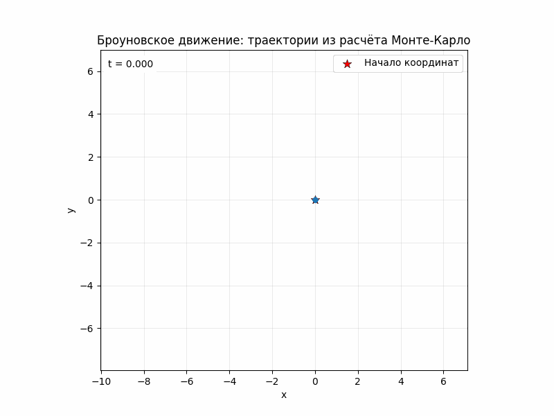
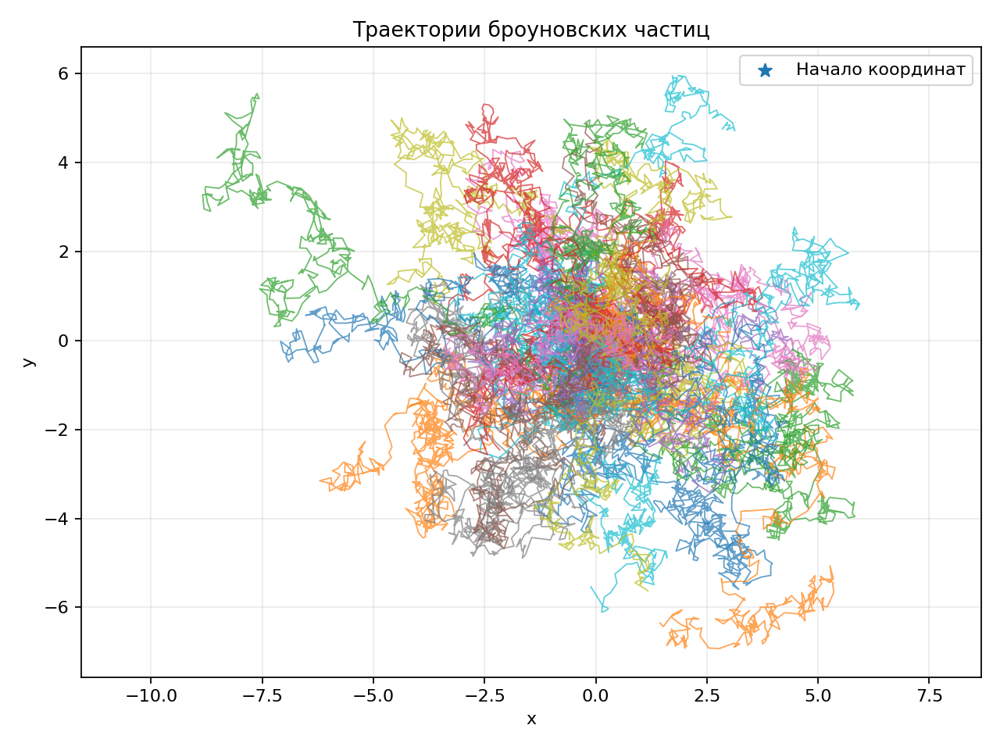
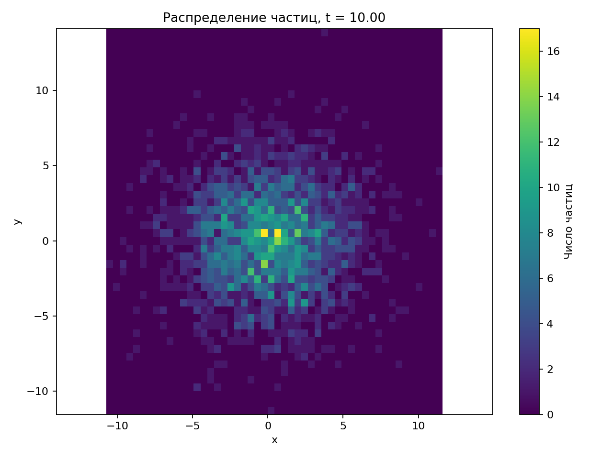
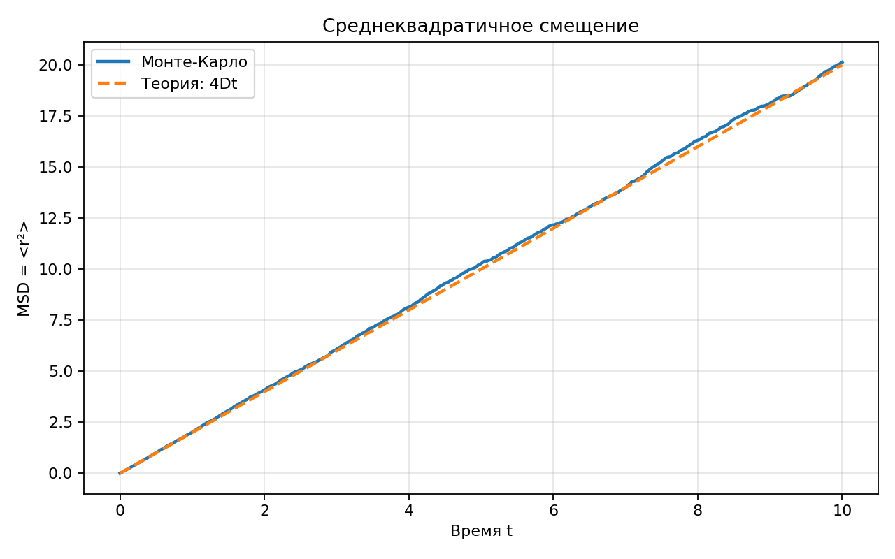
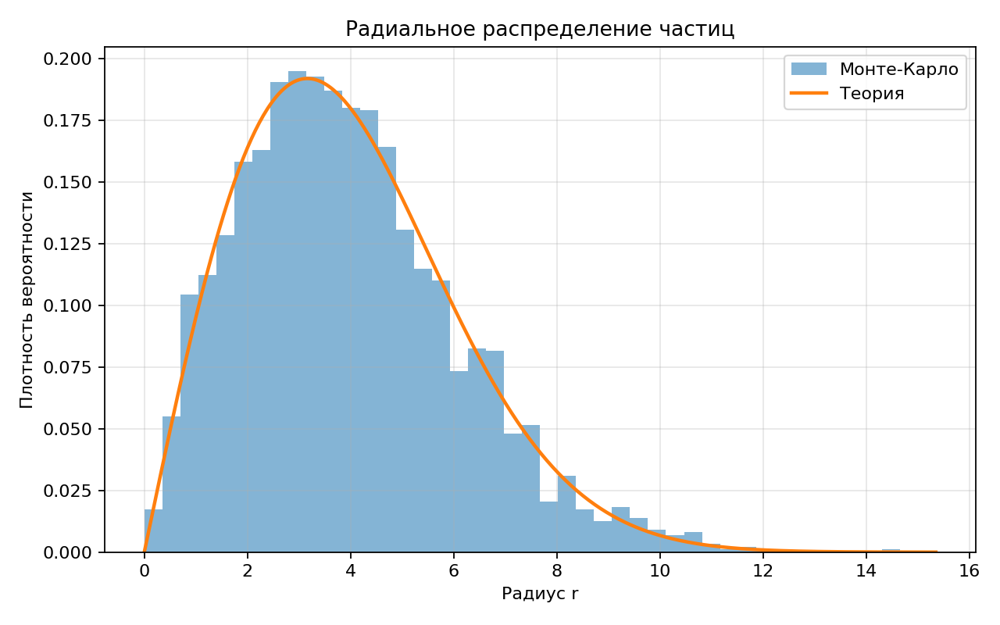

# Броуновское движение ансамбля частиц: стохастическое моделирование методом Монте-Карло

Программа исследует двумерное броуновское движение ансамбля независимых частиц в однородной изотропной среде. Случайное воздействие окружающей среды учитывается статистически: на каждом временном шаге для каждой частицы генерируются независимые гауссовы приращения координат.

**Цель работы** — построить имитационную модель случайного движения, исследовать пространственное распределение частиц и проверить результаты численного эксперимента по аналитическим соотношениям для броуновского движения: закону Эйнштейна для среднего квадрата смещения и распределению Рэлея для расстояния от начальной точки.



## 1. Физическая постановка задачи

Броуновское движение — это беспорядочное движение достаточно малых частиц, взвешенных в жидкости или газе. Оно возникает вследствие многочисленных хаотических столкновений частицы с молекулами окружающей среды. Поскольку число таких столкновений очень велико, а отдельные молекулярные импульсы не отслеживаются, движение взвешенной частицы на рассматриваемом масштабе описывается вероятностно.

В данной работе рассматривается **ансамбль частиц, совершающих свободное двумерное броуновское движение**. Все частицы стартуют из одной точки — начала координат. Затем их координаты изменяются под действием независимых случайных приращений. Для каждой частицы формируется отдельная траектория, а по всему ансамблю рассчитываются статистические характеристики.

Модель не воспроизводит траектории молекул растворителя и не рассчитывает отдельные столкновения. Микроскопическое воздействие среды заменяется случайным процессом с заданным коэффициентом диффузии.

### Принятые физические допущения

- рассматривается двумерное пространство с координатами $x$ и $y$;
- частицы независимы друг от друга и не взаимодействуют между собой;
- среда однородна и изотропна, поэтому коэффициент диффузии постоянен и одинаков по всем направлениям;
- внешние силы, направленный перенос, границы области и препятствия отсутствуют;
- частицы считаются точечными объектами, их размеры и вращение не учитываются;
- случайные приращения координат имеют нормальное распределение, нулевое математическое ожидание и одинаковую дисперсию по двум осям;
- начальные координаты всех частиц равны нулю;
- моделирование проводится в рамках классического диффузионного описания, без явного рассмотрения инерционного этапа движения.

Таким образом, это модель свободной диффузии независимых броуновских частиц, а не полноценная молекулярно-динамическая модель жидкости.

## 2. Математическая модель

### 2.1. Случайное перемещение за временной шаг

Пусть положение частицы в момент времени `t` задаётся радиус-вектором

$$
\mathbf r(t)=(x(t),y(t)).
$$

Для свободного броуновского движения при постоянном коэффициенте диффузии `D` приращения координат за интервал времени $Δt$ являются независимыми нормально распределёнными случайными величинами:

$$
\Delta x\sim\mathcal N(0,2DΔt),\qquad
\Delta y\sim\mathcal N(0,2DΔt).
$$

Здесь $\mathcal{N(0, 2DΔt)}$ означает нормальное распределение с математическим ожиданием, равным нулю, и дисперсией $2DΔt$. Стандартное отклонение каждого приращения равно

$$
\sigma_{\Delta}=\sqrt{2D\Delta t}.
$$

Координаты обновляются по формулам

$$
x_{n+1}=x_n+\Delta x_n,\qquad
 y_{n+1}=y_n+\Delta y_n.
$$

В векторной форме:

$$
\mathbf r_{n+1}=\mathbf r_n+\sqrt{2D\Delta t}\,\boldsymbol\xi_n,
$$

где компоненты вектора $\boldsymbol\xi_n$ — независимые случайные числа из стандартного нормального распределения $\mathcal N(0,1)$.

Для разных частиц и разных временных шагов используются независимые случайные приращения. Именно многократная генерация таких приращений образует ансамбль случайных траекторий.

### 2.2. Коэффициент диффузии

Коэффициент диффузии `D` характеризует интенсивность пространственного рассеяния частиц. Его размерность — квадрат длины, делённый на время. Чем больше `D`, тем большие перемещения в среднем совершают частицы за одинаковый промежуток времени.

Из выражения для дисперсии приращения следует, что характерный масштаб перемещения за один шаг пропорционален $\sqrt{D\Delta t}$, а не самому `D` или `Δt`.

В программе используются условные согласованные единицы: если время задаётся в выбранных единицах времени, координаты выражаются в соответствующих единицах длины, а `D` — в квадрате единицы длины на единицу времени. Перевод в конкретные физические единицы возможен после задания физического масштаба задачи.

### 2.3. Средний квадрат смещения и закон Эйнштейна

Для одной частицы квадрат расстояния от начальной точки равен

$$
r^2(t)=x^2(t)+y^2(t).
$$

Средний квадрат смещения (Mean Squared Displacement, MSD) по ансамблю из `N` частиц определяется как

$$
\mathrm{MSD}(t)=\langle r^2(t)\rangle
=\frac{1}{N}\sum_{i=1}^{N}\left[x_i^2(t)+y_i^2(t)\right].
$$

Для броуновского движения в одном измерении дисперсия координаты равна $2Dt$. В двух независимых измерениях вклады складываются:

$$
\langle x^2(t)\rangle=2Dt,\qquad
\langle y^2(t)\rangle=2Dt.
$$

Следовательно, для двумерного движения

$$
\boxed{\langle r^2(t)\rangle=\langle x^2+y^2\rangle=4Dt.}
$$

Это закон Эйнштейна для среднего квадрата смещения в двух измерениях. Он предсказывает линейную зависимость MSD от времени. Наклон теоретической прямой равен `4D`.

В программе экспериментальный MSD рассчитывается по ансамблю частиц, а затем сравнивается с теоретической зависимостью `4Dt`. Расхождение не означает автоматически ошибку алгоритма: при конечном числе частиц статистическая оценка отличается от математического ожидания.

### 2.4. Распределение координат и радиальное распределение

Так как приращения координат гауссовы и независимы, координаты частицы в момент `t` имеют двумерное нормальное распределение:

$$
p(x,y,t)=\frac{1}{4\pi Dt}
\exp\left(-\frac{x^2+y^2}{4Dt}\right),\qquad t>0.
$$

Это распределение описывает вероятность обнаружить частицу в окрестности точки `(x,y)` в заданный момент времени. Оно имеет круговую симметрию: вероятность зависит от расстояния до начала координат, а не от направления.

Если перейти от координат `(x,y)` к радиусу $r=\sqrt{x^2+y^2}$, плотность вероятности радиального расстояния имеет вид распределения Рэлея:

$$
\boxed{p_r(r,t)=\frac{r}{2Dt}
\exp\left(-\frac{r^2}{4Dt}\right),\quad r\geq0.}
$$

Радиальная плотность отличается от двумерной плотности по координатам множителем, связанным с площадью кольца радиуса `r` и толщины `dr`. Поэтому распределение расстояний не является просто сечением двумерной гауссовой функции.

В работе строится гистограмма конечных расстояний частиц от начала координат и сравнивается с аналитической плотностью Рэлея. Это даёт независимую проверку статистических свойств моделирования наряду с проверкой MSD.

## 3. Алгоритм Монте-Карло

На каждом шаге моделирования случайным образом формируются приращения координат всех частиц. Алгоритм состоит из следующих операций:

1. Задаются число частиц `N`, число шагов `M`, временной шаг `Δt`, коэффициент диффузии `D` и зерно генератора случайных чисел `seed`.
2. Все частицы помещаются в начало координат: $x_i(0)=0$, $y_i(0)=0$.
3. Вычисляется стандартное отклонение приращения $\sigma_{\Delta}=\sqrt{2D\Delta t}$.
4. Для каждой частицы и каждой координаты генерируется независимое случайное приращение из нормального распределения с нулевым средним и стандартным отклонением $\sigma_{\Delta}$.
5. Приращения добавляются к предыдущим координатам; так формируется следующий слой положений ансамбля.
6. Шаги 4–5 повторяются `M` раз.
7. По сохранённым координатам вычисляется MSD, конечное пространственное распределение и радиусы частиц.
8. Численные характеристики сопоставляются с аналитическими формулами, графики сохраняются в выходной каталог.

Метод Монте-Карло использует случайные величины для приближённого исследования вероятностной модели. В данном проекте случайными являются приращения координат частиц. Вместо поиска одной детерминированной траектории рассчитывается ансамбль возможных траекторий, а физические характеристики оцениваются статистически по этому ансамблю.

Фиксированное значение `seed` задаёт воспроизводимую последовательность псевдослучайных чисел. Это позволяет повторить эксперимент и получить те же численные результаты при одинаковых параметрах и программном окружении.

Для броуновского процесса выбранные приращения точно соответствуют распределению перехода между соседними моментами времени. Поэтому на временной сетке программа моделирует дискретные отсчёты винеровского процесса, а не приближает детерминированное уравнение движения методом Эйлера.

## 4. Вычислительные эксперименты и визуализация

В проекте формируются четыре основных графика.

### 4.1. Траектории частиц



На графике показаны траектории выбранных частиц в плоскости `(x,y)`. Каждая линия представляет последовательность положений одной частицы. Различие траекторий при одинаковых параметрах демонстрирует случайный характер процесса. Начальная точка всех траекторий совпадает с началом координат.

### 4.2. Пространственное распределение



Двумерная гистограмма показывает число частиц, попавших в ячейки плоскости к конечному моменту времени. В среднем распределение обладает круговой симметрией и наиболее концентрировано около начала координат. При увеличении времени область заметного рассеяния расширяется.

### 4.3. Средний квадрат смещения



На одном графике представлены ансамблевая оценка MSD и теоретическая прямая `4Dt`. С ростом числа частиц статистические флуктуации оценки обычно уменьшаются. При конечном ансамбле численная кривая не обязана точно совпадать с теорией в каждой точке.

### 4.4. Радиальное распределение



Гистограмма показывает распределение расстояний частиц от начальной точки в конечный момент времени. Гладкая кривая соответствует аналитической плотности Рэлея. Сравнение позволяет проверить не только второй момент распределения, но и его форму.

## 5. Параметры моделирования

Параметры можно менять при запуске из командной строки.

| Параметр | Значение по умолчанию | Физический / вычислительный смысл |
|---|---:|---|
| `--particles` | `1000` | Число независимых частиц в ансамбле `N` |
| `--steps` | `500` | Число временных шагов `M` |
| `--dt` | `0.02` | Продолжительность одного шага `Δt` |
| `--diffusion` | `0.5` | Коэффициент диффузии `D` |
| `--seed` | `42` | Зерно генератора псевдослучайных чисел |
| `--output` | `results` | Каталог для сохранения графиков |

Полное время моделирования определяется как

$$
T_{\mathrm{sim}}=M\Delta t.
$$

Для параметров по умолчанию `T_sim = 500 × 0.02 = 10`. Увеличение `N` улучшает статистическую представительность ансамбля, но увеличивает затраты памяти и времени. Изменение `D` меняет масштаб рассеяния: теоретический MSD пропорционален `D`. Изменение `Δt` меняет временную сетку и величину отдельного случайного приращения; при фиксированном полном времени распределение конечного смещения в идеальной модели остаётся тем же.

Пример запуска параметров эксперимента, использованного в отчёте:

```bash
python -m src.brownian_mc --particles 2500 --steps 500 --dt 0.02 --diffusion 0.5 --seed 42
```

Для этого набора конечное время равно `10`, а теоретический MSD в конце расчёта равен

$$
\mathrm{MSD}_{\mathrm{theory}}(10)=4\cdot0.5\cdot10=20.
$$

## 6. Выходные данные

После запуска программа создаёт каталог `results/` и сохраняет в него:

| Файл | Содержание |
|---|---|
| `trajectories.png` | Траектории до 40 частиц в плоскости `(x,y)` |
| `heatmap.png` | Двумерная гистограмма конечного распределения ансамбля |
| `msd.png` | Сравнение экспериментального MSD с законом Эйнштейна `4Dt` |
| `radial_distribution.png` | Гистограмма конечных радиусов и аналитическая плотность Рэлея |

В консоль выводятся число частиц, количество шагов, конечное время, экспериментальный и теоретический MSD, относительное отклонение и путь к сохранённым графикам.

## 7. Проверка результатов и статистическая точность

Основные проверки модели основаны на известных аналитических свойствах двумерного броуновского движения:

- начальные координаты всех частиц равны нулю;
- математическое ожидание каждого приращения координаты равно нулю;
- дисперсия приращения каждой координаты равна `2DΔt`;
- теоретический средний квадрат смещения равен `4Dt`;
- конечное радиальное распределение соответствует распределению Рэлея.

Вычисленный по конечному числу частиц MSD является случайной статистической оценкой. Поэтому его относительное отклонение от теории зависит от размера ансамбля и конкретной реализации генератора случайных чисел. Увеличение количества независимых частиц обычно повышает устойчивость статистических оценок. При этом фиксированный `seed` нужен для воспроизводимости, а не для повышения точности сам по себе.

Автоматические тесты проверяют форму массива положений и временной сетки, начальное состояние, воспроизводимость при фиксированном `seed`, обработку недопустимых параметров, аналитическую формулу MSD и неотрицательность вычисленного MSD.

## 8. Ограничения и область применимости

Модель описывает идеализированное свободное броуновское движение. Она не учитывает:

- явные столкновения броуновской частицы с молекулами растворителя;
- взаимное влияние частиц и их столкновения;
- гидродинамические взаимодействия и корреляции движения;
- неоднородность среды и зависимость коэффициента диффузии от координат;
- внешние поля, силы тяжести, поток жидкости и направленный дрейф;
- стенки, границы, поры, препятствия и ограниченную геометрию;
- конечный размер частиц и инерционные эффекты на очень малых временах.

Поэтому результаты характеризуют статистические закономерности свободной диффузии в рамках выбранной модели, но не являются прямым прогнозом для конкретной экспериментальной системы без задания её физических параметров и дополнительных механизмов.

## 9. Структура проекта

```text
LR3_Brownian_Motion/
├── src/
│   ├── __init__.py
│   └── brownian_mc.py       # модель, расчёт характеристик и построение графиков
├── tests/
│   └── test_brownian_mc.py  # автоматические тесты
├── assets/
│   ├── brownian_motion.gif  # анимация движения частиц
│   ├── trajectories.png
│   ├── heatmap.png
│   ├── msd.png
│   └── radial_distribution.png
├── results/                 # результаты запуска (создаётся программой)
├── requirements.txt
├── .gitignore
└── README.md
```

## 10. Установка и запуск

Требуется Python 3.10 или новее.

Создание виртуального окружения (рекомендуется):

```bash
python -m venv .venv
```

Активация в Windows PowerShell:

```powershell
.venv\Scripts\Activate.ps1
```

Активация в Linux/macOS:

```bash
source .venv/bin/activate
```

Установка зависимостей из корня проекта:

```bash
python -m pip install -r requirements.txt
```

Запуск моделирования с параметрами по умолчанию:

```bash
python -m src.brownian_mc
```

Запуск с параметрами эксперимента из отчёта:

```bash
python -m src.brownian_mc --particles 2500 --steps 500 --dt 0.02 --diffusion 0.5 --seed 42
```

Запуск с пользовательскими параметрами и отдельным каталогом результатов:

```bash
python -m src.brownian_mc --particles 3000 --steps 600 --dt 0.01 --diffusion 0.4 --seed 7 --output results_custom
```

## 11. Тестирование

Тесты запускаются из корневой папки проекта:

```bash
python -m pytest tests -v
```

Для тестирования необходим пакет `pytest`, который входит в `requirements.txt`. Тестовый файл не следует запускать как обычный Python-скрипт: его нужно передавать тестовому раннеру командой выше.

Формулы в README приведены для свободного двумерного броуновского движения с постоянным коэффициентом диффузии. Численная реализация находится в `src/brownian_mc.py`.
